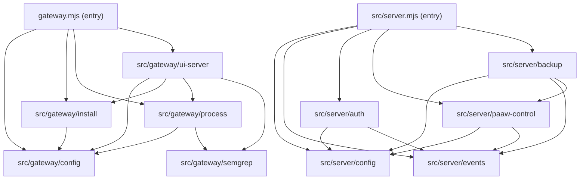

# Architecture — tpaaw-gateway 模組化重構施工圖

> 狀態：Proposed（2026-10-11）· 作者：Architect (Xiaowei Lin) · 對應 ADR-003
> 性質：**refactor-only（純結構搬移，不改行為）**。驗收門檻 = 既有測試全綠。

## 1. 背景與問題

| 檔案 | 行數 | 承擔職責 | 問題 |
|---|---|---|---|
| `gateway.mjs` | ~1166 | CLI 入口 + 套包下載/驗證/安裝 + 進程啟停/健康檢查 + semgrep 偵測安裝 + 內嵌 UI HTTP server + 大量模組級可變狀態 | 一檔 5 種職責；top-level await；共享可變狀態散落 |
| `src/server.mjs` | ~1015（含 ~300 行已註解死碼） | HTTP server + 認證/角色 + 進程生命週期 + 備份/還原 + 升級 + 健康監控 + 事件稽核 | 路由全部 inline `if`；死碼 `buildFallbackUI`（698–1016）未清 |

**驅動因素**：可維護性、可測試性、模組邊界明確化。**非目標**：不改任何對外行為、API 契約、CLI 介面。

## 2. 目標結構

### 2.1 `gateway.mjs` → 薄入口 + 5 模組

```
gateway.mjs                 # 入口：process.argv 分派 + cmdStatus/cmdUpdate/cmdStart/safeUpdate/hangAround + upload 分派
src/gateway/
  config.mjs                # GATEWAY_CFG 載入、VERSION_RE、paths、applyHome、saveGatewayCfg、L logger、logFile、semverGt、loadPackageServerUrl、readCurrent/writeCurrentAtomic/listInstalledVersions、augmentedPath、PORT/AUTO_UPDATE
  install.mjs               # downloadVerified、extractZip、verifySkeleton、run、installDeps、ensureData、stageInstall、installVersion、readZipManifest、installUploadedZip、updateLogic
  process.mjs               # startPaaw、childFailReason、waitForHealthy、killChild、isPortOccupied、startAndVerify、openBrowserTab（+ LAST_START_FAIL state 與 getter）
  semgrep.mjs               # semgrepVersion、semgrepPresence、checkSemgrep、semgrepCheckKick、runCapture、installSemgrep（+ SEMGREP_* state 與 getter）
  ui-server.mjs             # cmdUI、job state、jobLog、runJob、paawRunning、paawChild state、uiStart/uiStop/uiUpdate/uiStatus
```

### 2.2 `src/server.mjs` → 薄入口 + 5 模組（+ 刪死碼）

```
src/server.mjs              # 入口：createServer + 路由分派 + sendJSON/readBody/auth guard + main guard（保留檔名）
src/server/
  config.mjs                # loadConfig、saveConfig、config、PAAW_ROOT/BACKUP_DIR/EVENT_LOG/BACKUP_SOURCE_DIRS/MAX_BACKUPS
  events.mjs                # events buffer、logEvent
  auth.mjs                  # sessions、createSession、validateSession
  paaw-control.mjs          # paawProcess/paawStatus/paawPid 等 state、startPaaw、stopPaaw、restartPaaw、healthCheckPaaw、getSystemHealth、getCurrentVersion、getGitInfo、getLatestVersion、upgradePaaw
  backup.mjs                # BACKUP_REGEX、BACKUP_DATE_REGEX、backupPath、listBackups、createBackup、restoreBackup
```

## 3. 依賴方向（嚴格單向，禁止反向 / 循環）



- `config` 是 leaf（無內部依賴）。
- `process` → `semgrep`（因 `startPaaw` 需 `SEMGREP_DETECTED` 兜底注入）。
- `backup` → `paaw-control`（因 `restoreBackup` 需 `paawProcess` / `stopPaaw` / `startPaaw`）。
- **禁止**：`semgrep → ui`（用 logger 注入切斷）、`install → process`、任何反向邊。

## 4. 共享可變狀態歸屬（**最關鍵**）

| 狀態 | 目前位置 | 新 owner | 跨模組存取方式 |
|---|---|---|---|
| `GATEWAY_CFG` | gateway.mjs | `gateway/config` | 只讀 export；`saveGatewayCfg()` 為唯一寫入點 |
| `HOME/VERSIONS_DIR/DATA_DIR/CURRENT_FILE/LOGS_DIR` | gateway.mjs | `gateway/config` | export getter（`applyHome()` 會重算，故不可 export const 快照） |
| `paawChild`/`paawChildVersion` | gateway.mjs | `gateway/ui-server` | 模組內 private |
| `job` | gateway.mjs | `gateway/ui-server` | 模組內 private；`jobLog` 以參數注入 semgrep |
| `LAST_START_FAIL` | gateway.mjs | `gateway/process` | export `getLastStartFail()` |
| `SEMGREP_DETECTED`/`SEMGREP_CHECK_CACHE`/`SEMGREP_CHECK_STATE` | gateway.mjs | `gateway/semgrep` | export `getSemgrepDetected()` |
| `paawProcess/paawStatus/paawPid/...` | server.mjs | `server/paaw-control` | export getter（`isRunning()` 等），不 export 可寫變數 |
| `sessions` | server.mjs | `server/auth` | 模組內 private |
| `events` | server.mjs | `server/events` | export `getEvents(limit)` |
| `config`（server） | server.mjs | `server/config` | export `getConfig()`；`saveConfig()` 唯一寫入點 |

## 5. 路徑解析修正清單（搬檔後必改）

| 檔案 | 現值 | 新值 | 原因 |
|---|---|---|---|
| `gateway/ui-server.mjs` | `join(dirname(import.meta.url), "ui")` | `join(dirname(import.meta.url), "..", "..", "ui")` | ui-server 移到 `src/gateway/`，`ui/` 仍在 repo 根 |
| `src/server.mjs`（入口） | `join(__dirname, "..", "public", "index.html")` | `join(__dirname, "..", "public", "index.html")` **維持不變**（入口仍在 `src/`） | 入口檔不搬，勿動 |
| 各新模組的 `import` | — | 相對路徑改為 `./config.mjs` 等 | 依新目錄 |
| `package.json` `bin`/`scripts` | `gateway.mjs` | **不動** | 入口檔名保留 |

> `gateway.json` 由 `process.cwd()` 讀取，與檔案位置無關，不受影響。

## 6. 分期計畫

| Phase | 範圍 | effort | 風險 | 完成定義 |
|---|---|---|---|---|
| **P1** | `src/server.mjs` 拆 5 模組 + 刪死碼（698–1016） | M | 低（入口不動） | `npm test` 全綠；`node src/server.mjs` 起得來 |
| **P2** | `gateway.mjs` 拆 config / install / process | L | 中（共享狀態最多） | `npm test` 全綠；`node gateway.mjs status/update` 正常 |
| **P3** | `gateway.mjs` 拆 semgrep / ui-server + 瘦身入口 | M | 低 | `npm test` 全綠；`node gateway.mjs ui` 起得來、`/api/status` 回 200 |

每期結束後：`project_edit(feature_update_mapping)` 更新 file→feature mapping → `cu_refresh`。

## 7. 驗收條件（每期一致）

1. `npm test`（TAP，42 案 e2e + 10 unit = 52）**全綠、exit 0**。
2. `node src/server.mjs`（或 `node gateway.mjs ui`）能正常啟動、`/api/health` / `/api/status` 回 200。
3. 三個 e2e（`gateway-backup-auth` / `gateway-ui-csrf` / `gateway-restart-rbac`）以 spawn 真入口驗證，**入口檔名與行為不變**。
4. `git diff` 為**純搬移**（邏輯行不變，僅 import/路徑調整）；無新功能、無行為變更。
5. 無循環依賴（可用 `madge --circular` 或人工核對依賴圖）。

## 8. 風險與緩解

| 風險 | 說明 | 緩解 |
|---|---|---|
| 共享狀態循環依賴 | `HOME` 被 install/process/semgrep 共用 | 統一收在 `config`，其餘 import；見 §4 |
| `semgrep ↔ ui` 循環 | `installSemgrep`/`runCapture` 需 jobLog | logger 以參數注入，semgrep 不 import ui |
| 入口檔名綁定 | bin + 3 個 e2e spawn target | 保留 `gateway.mjs`、`src/server.mjs` |
| `import.meta.url` 路徑 | `ui/` 相對深度改變 | 見 §5 修正清單 |
| `applyHome()` 重算 | paths 非 const | export getter，不 export 快照 |
| 行為回歸 | 重構易夾帶改動 | refactor-only，靠 52 案測試把關 |
